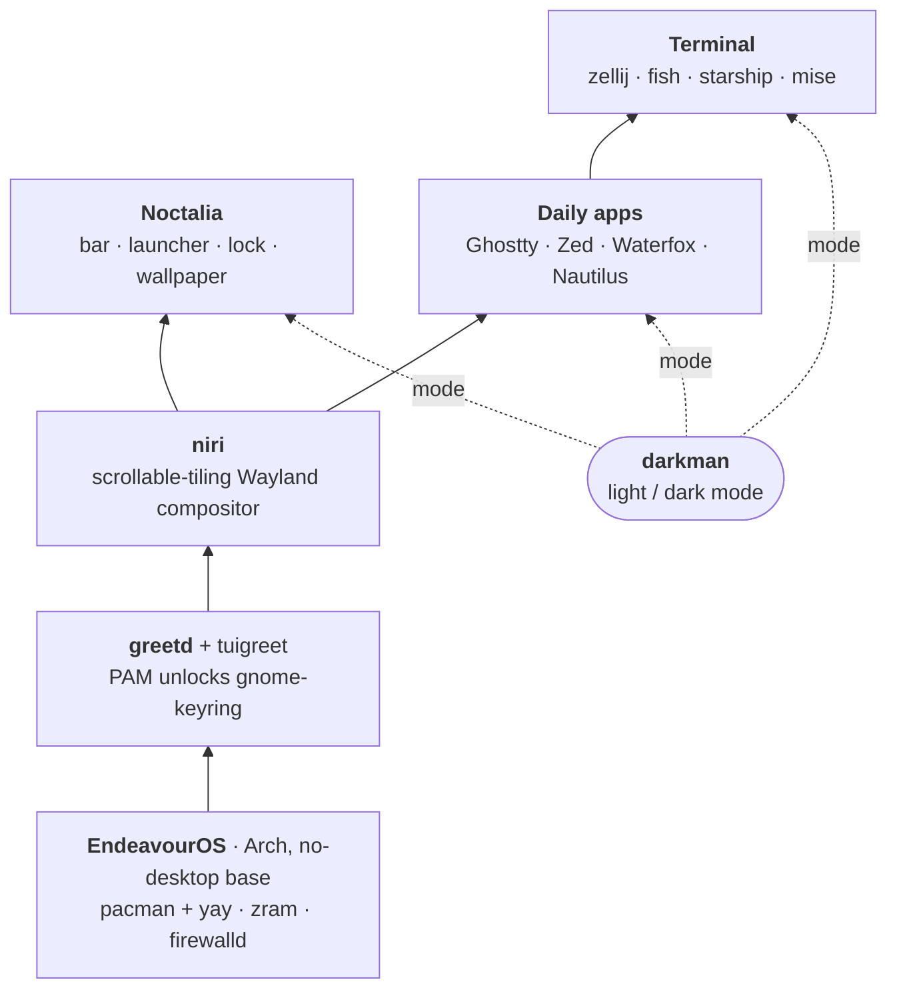
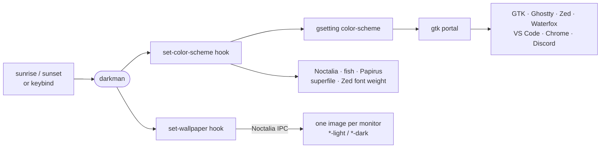
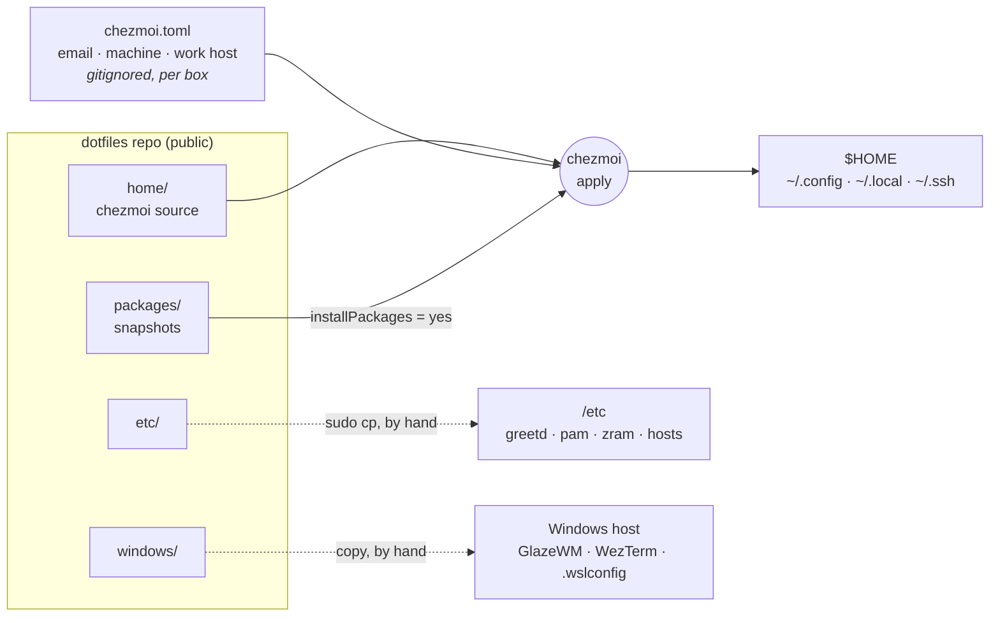

<h1 align="center">🏠 dotfiles</h1>

<p align="center">
  A personal EndeavourOS desktop — niri + Noctalia, managed with chezmoi.
</p>
<p align="center">
  <sub>Reproducible on a fresh machine, and safe to share publicly.</sub>
</p>

<p align="center">
  <a href="https://github.com/anIcedAntFA/dotfiles/actions/workflows/ci.yml"></a>
  <a href="LICENSE"></a>
  <a href="https://www.chezmoi.io/"></a>
</p>
<p align="center">
  <a href="https://archlinux.org"></a>
  <a href="https://github.com/niri-wm/niri"></a>
  <a href="https://github.com/noctalia-dev/noctalia-shell"></a>
  <a href="https://ghostty.org/"></a>
  <a href="https://fishshell.com/"></a>
  <a href="https://zed.dev/"></a>
  <a href="https://www.waterfox.com/"></a>
</p>

<!-- TODO: desktop screenshots (niri + Noctalia), one per mode, then uncomment.
<p align="center">
  <picture>
    <source media="(prefers-color-scheme: dark)" srcset="images/screenshot/desktop-dark.png">
    
  </picture>
</p>
-->

> [!NOTE]
> This is tuned for **my own machines**. Read each config before applying it —
> don't copy blindly. Everything private (emails, work host, location) is
> templated, so you supply your own values on first run.

## Contents

- [At a glance](#at-a-glance)
- [Architecture](#architecture)
- [How a machine gets configured](#how-a-machine-gets-configured)
- [Machine profiles](#machine-profiles)
- [Quick start](#quick-start)
- [Repo layout](#repo-layout)
- [Guides](#guides)
- [Development](#development)
- [Credits](#credits)

## At a glance

| Layer            | Choice                                                                                                                              |
| ---------------- | ----------------------------------------------------------------------------------------------------------------------------------- |
| **Distro**       | [EndeavourOS](https://endeavouros.com/) (Arch), "no desktop" base · [yay](https://github.com/Jguer/yay) for AUR                     |
| **Login**        | [greetd](https://sr.ht/~kennylevinsen/greetd/) + tuigreet                                                                           |
| **Compositor**   | [niri](https://github.com/niri-wm/niri) — scrollable tiling, Wayland                                                                |
| **Shell (UI)**   | [Noctalia](https://github.com/noctalia-dev/noctalia-shell) — bar, launcher, lock screen, wallpaper                                  |
| **Light / dark** | [darkman](https://darkman.whynothugo.nl/) — sunrise/sunset schedule + keybind, fanned out to every app                              |
| **Terminal**     | [Ghostty](https://ghostty.org/) + [zellij](https://zellij.dev/) · [fish](https://fishshell.com/) + [starship](https://starship.rs/) |
| **Editor**       | [Zed](https://zed.dev/) daily, [VS Code](https://code.visualstudio.com/) alongside                                                  |
| **Browser**      | [Waterfox](https://www.waterfox.com/)                                                                                               |
| **Files**        | [Nautilus](https://apps.gnome.org/Nautilus/) (GUI) · [superfile](https://superfile.dev/) (TUI)                                      |
| **Runtimes**     | [mise](https://mise.jdx.dev/) — node, pnpm, go, bun, yarn                                                                           |
| **Secrets**      | [gopass](https://www.gopass.pw/) (GPG + git) · gnome-keyring for desktop apps                                                       |
| **Dotfiles**     | [chezmoi](https://www.chezmoi.io/) — [why (ADR)](docs/adr/0001-adopt-chezmoi.md)                                                    |

## Architecture

Each layer starts the one above it. **darkman** sits beside the stack: it owns
the light/dark mode and pushes it to every layer
([theme-sync.md](docs/theme-sync.md)).



<details>
<summary>How one light/dark switch reaches every app</summary>



Apps that read the portal follow on their own. The hook drives the rest
directly. The wallpaper has no portal fallback, which is why it gets its own
hook. See [ADR 0019](docs/adr/0019-darkman-owns-mode-noctalia-follows.md).

</details>

## How a machine gets configured

Only `home/` goes through chezmoi. Your private answers live in a gitignored
`chezmoi.toml` on each machine, never in this repo. Files under `etc/` and
`windows/` are copied **by hand**, since they need root or another OS.



## Machine profiles

One config, three boxes. The `machine` answer picks the **profile**. Templates
such as niri outputs, Noctalia DPI and wallpapers branch on it
([ADR 0006](docs/adr/0006-per-machine-niri-via-chezmoi-template.md)).

| Profile  | Outputs                                | Extras beyond the shared snapshot |
| -------- | -------------------------------------- | --------------------------------- |
| `home`   | `DP-3` landscape + `HDMI-A-1` portrait | NVIDIA driver stack               |
| `work`   | `DP-1` landscape + `HDMI-A-2` portrait | —                                 |
| `laptop` | `eDP-1` internal panel                 | `brightnessctl`                   |

There is a second, independent question: **where** the config runs. On a
**Desktop host** (Linux on the hardware) everything applies. In a **WSL guest**
only the terminal layer applies, and the **Windows host** around it provides
the desktop ([windows.md](docs/windows.md)). Terms are defined in
[CONTEXT.md](CONTEXT.md).

## Quick start

> [!WARNING]
> Applying these dotfiles overwrites files in your `$HOME`. Review first, and
> ideally test in a VM or a fresh user account.

```sh
# 1. Install chezmoi
yay -S --needed chezmoi

# 2. Clone and apply. You'll be asked for your email, name, work git host,
#    ghq roots, machine profile, location (for sunrise/sunset), and whether
#    to install packages.
chezmoi init --apply https://github.com/anIcedAntFA/dotfiles.git

# 3. Preview later changes before applying them
chezmoi diff
```

If you skipped automatic package install, install the shared snapshot yourself,
then any [per-profile extras](docs/packages.md#per-profile-extras):

```sh
yay -S --needed - < packages/pacman-explicit.txt
yay -S --needed - < packages/aur.txt
```

## Repo layout

```text
dotfiles/
├── home/                    chezmoi source (.chezmoiroot points here)
│   ├── .chezmoi.toml.tmpl     first-run prompts → your private chezmoi.toml
│   ├── .chezmoiscripts/       run_onchange: packages, VS Code extensions, darkman
│   ├── dot_config/            → ~/.config  (niri, noctalia, fish, ghostty, zed, …)
│   ├── dot_local/             → ~/.local   (bin/ helpers, darkman hooks)
│   ├── private_dot_ssh/       → ~/.ssh     (0600, templated hosts)
│   └── private_dot_gnupg/     → ~/.gnupg
├── etc/                     /etc files, applied by hand (greetd, pam, zram, pacman)
├── windows/                 Windows-host config, applied by hand (GlazeWM, WezTerm, WSL)
├── packages/                snapshots: desktop, WSL, winget, VS Code extensions
├── docs/                    per-tool guides
│   ├── adr/                   Architecture Decision Records
│   └── research/              source notes behind larger decisions
├── images/
│   ├── wallpaper/             <subject>-light / -dark pairs + CREDITS.md
│   └── thumbnail/             fastfetch logo art sources
├── CONTEXT.md               glossary: the words this repo uses, and the ones it avoids
└── mise.toml · justfile · dprint.json · lefthook.yml · .github/   tooling
```

## Guides

Each guide covers **what the tool is, why it's here, and how it's set up**.
Larger decisions are recorded as [ADRs](docs/adr/).

<details open>
<summary>Desktop — niri, Noctalia, login, theming</summary>

| Guide                                             | About                                                     |
| ------------------------------------------------- | --------------------------------------------------------- |
| [niri.md](docs/niri.md)                           | The compositor + Noctalia shell (start here)              |
| ⤷ [niri-concepts.md](docs/niri-concepts.md)       | Mental model: columns, workspaces, outputs                |
| ⤷ [niri-config.md](docs/niri-config.md)           | Config walkthrough, one file for three machines           |
| ⤷ [niri-keybindings.md](docs/niri-keybindings.md) | Every keybind ↔ action                                    |
| [theme-sync.md](docs/theme-sync.md)               | Light/dark sync: darkman + gtk portal, schedule + keybind |
| [greetd.md](docs/greetd.md)                       | Login manager, tuigreet, quiet boot                       |
| ⤷ [secret-service.md](docs/secret-service.md)     | Desktop keychain: gnome-keyring auto-unlock via PAM       |
| [xdg-environment.md](docs/xdg-environment.md)     | `/etc/environment` vs `environment.d` vs portals          |
| [fcitx5.md](docs/fcitx5.md)                       | Vietnamese input (Bamboo)                                 |
| [screenshot.md](docs/screenshot.md)               | grim + slurp + satty                                      |
| [screen-recording.md](docs/screen-recording.md)   | GPU screen recording                                      |
| [clipboard.md](docs/clipboard.md)                 | Clipboard history (cliphist + Noctalia launcher)          |

</details>

<details>
<summary>Terminal & shell — Ghostty, fish, prompt, search</summary>

| Guide                             | About                                                   |
| --------------------------------- | ------------------------------------------------------- |
| [ghostty.md](docs/ghostty.md)     | Terminal: keybinds, transparency, cursor shaders        |
| ⤷ [zellij.md](docs/zellij.md)     | Multiplexer: sessions, project layouts, the `zj` picker |
| [fish.md](docs/fish.md)           | Shell, plugins, keybindings, secrets pattern            |
| ⤷ [starship.md](docs/starship.md) | Prompt layout, the TOML quoting trap, module cost       |
| ⤷ [zoxide.md](docs/zoxide.md)     | Frecency directory jumping (`z` / `zi`)                 |
| [fastfetch.md](docs/fastfetch.md) | System-info banner with random per-mode logos           |
| [ripgrep.md](docs/ripgrep.md)     | Fast content search, and what a search silently skips   |
| ⤷ [fd.md](docs/fd.md)             | Find files by name; global ignore file                  |
| [ghq.md](docs/ghq.md)             | Organized repo cloning + fuzzy jumping                  |
| [direnv.md](docs/direnv.md)       | Per-directory environments                              |
| [archives.md](docs/archives.md)   | 7zz · ouch · PeaZip                                     |

</details>

<details>
<summary>Editors & development — Zed, VS Code, runtimes, AI agents</summary>

| Guide                                 | About                                                         |
| ------------------------------------- | ------------------------------------------------------------- |
| [zed.md](docs/zed.md)                 | Curated config, per-mode font weight, keymap cheat-sheet      |
| [vscode.md](docs/vscode.md)           | Themes, custom.css font weight, formatter routing, extensions |
| [waterfox.md](docs/waterfox.md)       | Install, pinned profile, policies, vertical tabs              |
| [mise.md](docs/mise.md)               | Global runtimes vs this repo's pinned tooling                 |
| [git.md](docs/git.md)                 | Identities, `includeIf`, SSH commit signing                   |
| [docker.md](docs/docker.md)           | Engine setup, rootless use, daemon config                     |
| [claude-code.md](docs/claude-code.md) | Personal + work accounts, the `rg`/`fd` search rule           |
| [rtk.md](docs/rtk.md)                 | Token proxy for AI agents, and what compression costs         |

</details>

<details>
<summary>Security & network — keys, passwords, certs, VPN</summary>

| Guide                             | About                                      |
| --------------------------------- | ------------------------------------------ |
| [ssh.md](docs/ssh.md)             | SSH keys per host (personal + work)        |
| [gopass.md](docs/gopass.md)       | Terminal password manager (GPG + git)      |
| [certs.md](docs/certs.md)         | Corporate CA certs, trust-store restore    |
| [vpn.md](docs/vpn.md)             | Corporate VPN (GlobalProtect / `gpclient`) |
| [firewalld.md](docs/firewalld.md) | Exposing a dev server to your LAN          |

</details>

<details>
<summary>System — packages, memory, dotfile workflow, Windows</summary>

| Guide                           | About                                                      |
| ------------------------------- | ---------------------------------------------------------- |
| [chezmoi.md](docs/chezmoi.md)   | Daily workflow: templates, add / re-add, diff              |
| [packages.md](docs/packages.md) | What's installed and why; snapshots and per-profile extras |
| [zram.md](docs/zram.md)         | Compressed RAM swap, and why zero swap kills apps          |
| [windows.md](docs/windows.md)   | Windows host + Arch WSL guest: the split and setup order   |

</details>

<details>
<summary>Theory (tiếng Việt)</summary>

| Guide                                                         | About                                                     |
| ------------------------------------------------------------- | --------------------------------------------------------- |
| [memory-swap-concepts.vi.md](docs/memory-swap-concepts.vi.md) | RAM, paging, OOM, zram vs zswap: the _why_ behind zram    |
| [search-concepts.vi.md](docs/search-concepts.vi.md)           | grep vs rg, find vs fd, and what a search silently misses |

</details>

## Development

This repo formats and lints itself. See [CONTRIBUTING.md](CONTRIBUTING.md).

```sh
mise trust    # once: allow this repo's mise.toml
just setup    # install the pinned tooling + git hooks
just check    # format check + lint + secret scan (what CI runs)
just fmt      # auto-format everything
```

Every dev tool is pinned to an exact version in [`mise.toml`](mise.toml), so CI
and every checkout run the same ones. Upgrade on purpose with `mise up --bump`.
There's no Node or pnpm in the repo
([ADR 0007](docs/adr/0007-node-free-toolchain-via-mise.md)).

| Job     | Tools                                                                                            |
| ------- | ------------------------------------------------------------------------------------------------ |
| Format  | [dprint](https://dprint.dev/) (md/json/yaml/toml) · `shfmt` · `fish_indent`                      |
| Lint    | [rumdl](https://github.com/rvben/rumdl) (Markdown) · `shellcheck` · `just validate-niri` (local) |
| Secrets | [gitleaks](https://github.com/gitleaks/gitleaks) in the pre-commit hook, pre-push and CI         |

## Credits

Heavy inspiration from:

- [devaslife](https://github.com/craftzdog/dotfiles-public) — Takuya Matsuyama
- [mantran1611](https://github.com/manhtran1611/dotfiles) — Manh Tran
- [lazarus2019](https://github.com/lazarus2019) — Thai Son
- [nickjj](https://github.com/nickjj/dotfriedrice) — Nick Janetakis

Wallpaper sources and licences: [images/wallpaper/CREDITS.md](images/wallpaper/CREDITS.md).

Many thanks to my colleagues at **NDVN** for introducing me to Linux and guiding
me along the way. You're amazing and kind. 🙏

## License

[MIT](LICENSE) © ngockhoi96
