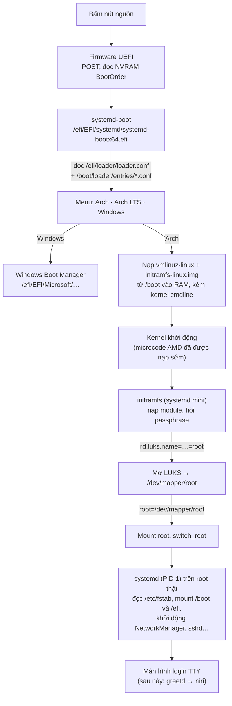

# Firmware, đĩa, boot & mạng — hiểu từ gốc

> Tài liệu **lý thuyết**: giải thích _vì sao_ một máy Linux khởi động được và lên
> mạng được, từ firmware tới DNS. Nó **không** phải hướng dẫn cài đặt.
>
> - Cần **làm từng bước** trên laptop → xem runbook [`arch-install.vi.md`](arch-install.vi.md).
> - Cần **dữ kiện phần cứng + nguồn trích dẫn** → xem [research note](research/arch-install-ideapad-5-pro-14.md).
> - Cần **hiểu tại sao mỗi bước tồn tại** → bạn đang ở đúng chỗ.

Mọi ví dụ trong tài liệu này lấy từ máy thật: IdeaPad 5 Pro 14ACN6, ổ NVMe 1 TB,
dual-boot Windows + Arch.

---

## 1. TL;DR

- **Firmware (UEFI) là chương trình đầu tiên chạy khi bấm nút nguồn.** Nó không
  biết Linux là gì; nó chỉ biết đọc phân vùng **FAT** và chạy một file `.efi`
  mà danh sách **boot entry** trong NVRAM chỉ tới.
- **Phân vùng ESP** (FAT32) là "sảnh chờ" chung, nơi mọi hệ điều hành đặt
  bootloader của mình. ESP của Windows trên máy này chỉ **100 MB**, quá nhỏ cho
  kernel Linux, nên kernel nằm ở một phân vùng riêng tên **XBOOTLDR** (`/boot`).
- **Bootloader** (systemd-boot) đọc file cấu hình text, nạp **kernel** và
  **initramfs** vào RAM, rồi giao quyền cho kernel cùng một dòng tham số gọi là
  **kernel command line**.
- **initramfs** là một hệ thống Linux tí hon nằm trong RAM. Việc chính của nó ở
  máy này: **hỏi passphrase, mở khoá LUKS**, mount root thật, rồi nhường chỗ.
- **LUKS** mã hoá cả phân vùng root. Mất laptop thì dữ liệu vẫn là rác ngẫu nhiên.
  Cái giá: `/boot` buộc phải **không** mã hoá (firmware không đọc được ổ mã hoá).
- **Mạng có ba tầng việc tách biệt:** _kết nối_ (Wi-Fi/cáp), _có địa chỉ IP_
  (DHCP), _biết tên ↔ địa chỉ_ (DNS, mDNS). Lỗi "không vào mạng được" luôn nằm ở
  đúng một tầng, và mỗi tầng có lệnh kiểm tra riêng.

---

## 2. ELI5 (giải thích như cho trẻ con)

Tưởng tượng máy tính là **một toà nhà**, và việc khởi động là **đưa một vị khách
(hệ điều hành) từ cổng vào tới phòng làm việc**.

- **Bảo vệ ở cổng là firmware (UEFI).** Ông ấy chỉ đọc được một thứ tiếng (FAT)
  và cầm một **danh sách khách quen** (boot entries): "Windows thì vào cửa A, Arch
  thì vào cửa B". Ông không biết trong toà nhà có gì.
- **Sảnh chờ là ESP.** Mỗi hệ điều hành để ở đó một **người dẫn đường**
  (bootloader). Sảnh nhà này bé (100 MB) vì Windows xây trước, chỉ đủ chỗ cho
  người dẫn đường chứ không đủ cho hành lý.
- **Phòng gửi đồ cạnh sảnh là XBOOTLDR.** Hành lý của Linux (kernel, initramfs)
  để ở đây. Người dẫn đường của Arch (systemd-boot) biết lối sang phòng này.
- **Phòng làm việc thật là root**, và nó **khoá bằng két sắt** (LUKS). Người dẫn
  đường không có chìa. Nên Linux gửi trước một **người giữ khoá** (initramfs):
  anh ta hỏi bạn mật mã, mở két, mở cửa phòng, rồi rút lui.
- **Mạng** là hệ thống bưu điện: phải **có đường** tới bưu điện (Wi-Fi), phải
  **có số nhà** (IP, xin qua DHCP), và phải có **danh bạ** để đổi tên thành số
  nhà (DNS). Trong khu phố nhỏ (LAN), hàng xóm có thể **hô to tên mình** cho
  nhau nghe mà không cần danh bạ (mDNS, `.local`).

---

## 3. Firmware: BIOS, UEFI và NVRAM

### 3.1 BIOS cũ vs UEFI

|                       | **BIOS (legacy)**                            | **UEFI**                                                               |
| --------------------- | -------------------------------------------- | ---------------------------------------------------------------------- |
| Cách tìm hệ điều hành | Đọc 446 byte đầu tiên của đĩa (MBR), chạy mù | Đọc **file** `.efi` trên một phân vùng FAT, theo danh sách trong NVRAM |
| Bảng phân vùng        | MBR (tối đa 4 phân vùng chính, đĩa ≤ 2 TiB)  | **GPT** (128 phân vùng, đĩa khổng lồ)                                  |
| Nhiều hệ điều hành    | Tranh nhau 446 byte MBR, cái cài sau ghi đè  | Mỗi hệ điều hành một thư mục trong ESP, cùng tồn tại                   |
| Bảo mật               | Không có                                     | **Secure Boot**: chỉ chạy file `.efi` được ký                          |

Laptop này (và mọi máy từ khoảng 2012) chạy UEFI. Kiểm tra trên ISO:

```sh
cat /sys/firmware/efi/fw_platform_size   # 64 → UEFI 64-bit; file không tồn tại → đang boot BIOS
```

### 3.2 NVRAM boot entries — đọc output của `efibootmgr`

UEFI lưu danh sách boot entry trong **NVRAM**, một vùng nhớ nhỏ trên bo mạch chủ,
không nằm trên đĩa. Đây là output thật của laptop (rút gọn):

```text
BootCurrent: 0004
Timeout: 0 seconds
BootOrder: 0004,2001,0001,0005,0003,0002,2002,2003
Boot0001* Fedora               HD(1,GPT,452b…,0x800,0x32000)/\EFI\fedora\shimx64.efi
Boot0003* Windows Boot Manager HD(1,GPT,452b…,0x800,0x32000)/\EFI\Microsoft\Boot\bootmgfw.efi
Boot0004* endeavouros          HD(1,GPT,452b…,0x800,0x32000)/\EFI\endeavouros\grubx64.efi
Boot0005* archcraft            HD(1,GPT,452b…,0x800,0x32000)/\EFI\archcraft\grubx64.efi
Boot2001* EFI USB Device
```

Đọc từng phần của một dòng:

- `Boot0004` — số hiệu entry (hex).
- `*` — entry đang bật.
- `endeavouros` — nhãn hiện trong menu F12.
- `HD(1,GPT,452b…,0x800,0x32000)` — **phân vùng số 1** trên một đĩa GPT, có
  partition GUID `452b…`, bắt đầu ở sector `0x800` (= 2048, tức 1 MiB) và dài
  `0x32000` sector (= 204800 × 512 byte = **100 MiB**). Đó chính là ESP.
- `/\EFI\endeavouros\grubx64.efi` — đường dẫn file trong ESP (UEFI dùng `\`
  kiểu Windows).
- `BootOrder` — thứ tự firmware thử. `BootCurrent: 0004` cho biết lần này máy
  boot vào EndeavourOS.

Hai điều rút ra:

1. **Boot entry là con trỏ, không phải bản thân bootloader.** Xoá thư mục
   `\EFI\fedora` mà không xoá `Boot0001` thì để lại một con trỏ chết. Xoá
   `Boot0001` mà giữ thư mục thì file vẫn chiếm chỗ trong ESP 100 MB. Dọn phải
   dọn **cả hai**.
2. **Fedora và archcraft là rác từ các lần cài trước.** Chúng không ảnh hưởng gì
   cho tới khi ESP đầy.

### 3.3 Secure Boot

Secure Boot là một chuỗi chữ ký: firmware giữ một danh sách khoá (PK → KEK →
`db`), và chỉ chạy file `.efi` được ký bởi khoá trong `db`. Khoá mặc định trong
`db` là của Microsoft.

- **Windows** được Microsoft ký → chạy được.
- **Fedora/Ubuntu** dùng **shim**: một bootloader nhỏ được Microsoft ký, rồi shim
  tự kiểm chữ ký của phần còn lại (thấy `shimx64.efi` trong output trên).
- **ISO Arch không có shim, không được ký** → phải **tắt Secure Boot** để boot
  ISO, và hệ thống Arch cài xong cũng không boot được khi Secure Boot bật.

Bật lại được về sau bằng cách **tự tạo khoá và tự ký** (công cụ `sbctl`). Đó là
việc của một phụ lục sau này, khi hệ thống đã ổn định.

### 3.4 Fast Startup của Windows, và vì sao nó khoá ổ NTFS

"Shut down" trên Windows 10/11 mặc định **không tắt hẳn**: nó log out người dùng
rồi **hibernate phần kernel** (Fast Startup). Ổ NTFS vì thế được đánh dấu là
"đang dùng dở". Linux thấy dấu đó sẽ từ chối mount ghi, để không phá dữ liệu
Windows đang treo trong file hibernate.

`powercfg /h off` tắt hibernate và Fast Startup cùng lúc. **Restart** (khác với
Shut down) luôn là tắt thật, nên đó là cách an toàn để rời Windows.

**BitLocker** liên quan vì nó dùng TPM để đo trạng thái firmware, trong đó có
Secure Boot. Đổi Secure Boot thì TPM thấy "máy đã bị thay đổi" và đòi recovery
key. Laptop này **không bật BitLocker** (`Protection Status: Protection Off`), nên
bỏ qua được rủi ro đó.

---

## 4. Đĩa: GPT, phân vùng, filesystem

### 4.1 GPT và "loại phân vùng"

GPT là bảng mục lục ở đầu (và một bản sao ở cuối) đĩa. Mỗi phân vùng có:

- vị trí bắt đầu/kết thúc;
- một **partition GUID** riêng (định danh _phân vùng này_);
- một **partition type GUID** (định danh _loại_ phân vùng: "đây là ESP", "đây là
  phân vùng Linux"…). Hệ điều hành và bootloader dựa vào loại để biết phân vùng
  dùng làm gì.

Layout thật của laptop (`lsblk -o NAME,SIZE,FSTYPE,PARTTYPENAME`):

| Phân vùng   | Cỡ     | Filesystem | Loại GPT                     | Vai trò                                   |
| ----------- | ------ | ---------- | ---------------------------- | ----------------------------------------- |
| `nvme0n1p1` | 100 MB | vfat       | EFI System                   | **ESP**, chung cho Windows và Linux       |
| `nvme0n1p2` | 16 MB  | —          | Microsoft reserved           | Windows dùng nội bộ, không có filesystem  |
| `nvme0n1p3` | 462 GB | ntfs       | Microsoft basic data         | Ổ `C:`                                    |
| `nvme0n1p4` | 1 GB   | ext4       | **Linux extended boot**      | **XBOOTLDR** (`/boot`) của EndeavourOS cũ |
| `nvme0n1p5` | 468 GB | ext4       | Linux filesystem             | Root của EndeavourOS cũ                   |
| `nvme0n1p6` | 530 MB | ntfs       | Windows recovery environment | WinRE, nằm **sau** phân vùng Linux        |

Để ý: `p6` (WinRE) nằm ở **cuối đĩa**, sau phân vùng Linux. Số thứ tự phân vùng
không nói lên vị trí vật lý. Đây là lý do runbook không bao giờ "xoá hết từ p4
trở đi".

### 4.2 Filesystem: vì sao ESP là FAT, root là ext4

Filesystem là cách sắp xếp byte trên phân vùng thành file và thư mục.

| Filesystem | Ai đọc được                          | Dùng ở đây cho | Vì sao                                                            |
| ---------- | ------------------------------------ | -------------- | ----------------------------------------------------------------- |
| **FAT32**  | Firmware UEFI, Windows, Linux, macOS | ESP, XBOOTLDR  | Spec UEFI bắt buộc firmware đọc được FAT. Đơn giản, không journal |
| **ext4**   | Linux                                | Root           | Journal, quyền Unix, symlink, ổn định, là chuẩn của các box khác  |
| **NTFS**   | Windows (Linux đọc/ghi qua `ntfs3`)  | Ổ `C:`         | Của Windows, không đụng tới                                       |

FAT không có quyền Unix (owner, mode). Linux phải **giả lập** quyền lúc mount
bằng tuỳ chọn `fmask`/`dmask`. Runbook mount ESP và `/boot` với
`fmask=0077,dmask=0077` (chỉ root đọc được), vì ESP chứa file `random-seed` của
systemd-boot. Nếu để mọi user đọc được file đó, `bootctl` sẽ cảnh báo lỗ hổng bảo
mật.

### 4.3 ESP vs XBOOTLDR — vì sao có hai phân vùng boot

Một kernel Linux (`vmlinuz-linux`) khoảng 15 MB, initramfs 20–40 MB. Với hai kernel
(`linux` + `linux-lts`) là cỡ 100–150 MB. ESP Windows 100 MB, đã có sẵn Windows
Boot Manager (~30 MB) → **không đủ chỗ**.

Mở rộng ESP thì phải dịch chuyển ổ `C:` (rủi ro, phiền). Giải pháp chuẩn hoá
trong [Boot Loader Specification](https://uapi-group.org/specifications/specs/boot_loader_specification/)
là phân vùng **XBOOTLDR** (type GUID `bc13c2ff-…`): "phần nối dài của ESP" để
chứa kernel. Hai phân vùng chia việc:

```text
/efi  (ESP, p1, 100 MB, FAT32)          /boot  (XBOOTLDR, p4, 1 GiB, FAT32)
├── EFI/                                ├── vmlinuz-linux
│   ├── Microsoft/Boot/bootmgfw.efi     ├── initramfs-linux.img
│   ├── systemd/systemd-bootx64.efi     ├── vmlinuz-linux-lts
│   └── BOOT/BOOTX64.EFI                ├── initramfs-linux-lts.img
└── loader/                             └── loader/entries/
    ├── loader.conf  ← cấu hình menu        ├── arch.conf
    └── random-seed                         └── arch-lts.conf
```

**Vì sao `p4` phải đổi từ ext4 sang FAT32?** EndeavourOS dùng GRUB, và GRUB tự
mang driver ext4 nên đọc được `/boot` ext4. systemd-boot thì **không mang driver
filesystem nào**: nó mượn driver của firmware, mà firmware chỉ chắc chắn có FAT.
Đổi bootloader kéo theo đổi filesystem của `/boot`.

---

## 5. LUKS: mã hoá toàn bộ phân vùng

### 5.1 Các lớp

```text
Phân vùng thật  /dev/nvme0n1p5     ← trên đĩa là byte ngẫu nhiên
      │  LUKS header (đầu phân vùng): keyslots, salt, thông số
      ▼  cryptsetup open + passphrase
Thiết bị ảo     /dev/mapper/root   ← kernel giải mã on-the-fly (dm-crypt)
      │
      ▼  mount
Filesystem      ext4 tại /
```

- **dm-crypt** là module kernel làm việc mã hoá/giải mã từng sector khi đọc/ghi.
- **LUKS** là _định dạng_ của header đặt ở đầu phân vùng. Nó cho biết dùng thuật
  toán gì, và chứa các **keyslot**.
- **`/dev/mapper/root`** là thiết bị ảo: đọc từ nó là đọc dữ liệu đã giải mã.
  Mọi thứ phía trên (ext4, `mount`, `fstab`) không hề biết có mã hoá.

### 5.2 Passphrase không phải là khoá

Dữ liệu được mã hoá bằng một **master key** ngẫu nhiên (sinh lúc
`luksFormat`). Passphrase chỉ dùng để **mở khoá một keyslot** chứa bản mã hoá của
master key đó:


Hệ quả thực tế:

- **Đổi passphrase không phải mã hoá lại 468 GB**, chỉ phải ghi lại một keyslot.
- **Có thể có nhiều passphrase** (nhiều keyslot), ví dụ một passphrase dài cất
  trong password manager làm dự phòng. Runbook gợi ý làm việc này.
- **argon2id cố tình chậm** (~1–2 giây, tốn nhiều RAM) để kẻ trộm không thử được
  hàng tỷ passphrase mỗi giây.
- **Hỏng header là mất hết**, kể cả khi nhớ passphrase. `cryptsetup
  luksHeaderBackup` tạo bản sao header để cất ngoài máy.

### 5.3 Cái gì được bảo vệ, cái gì không

| Tình huống                                                                        | LUKS (cấu hình này) có bảo vệ?                              |
| --------------------------------------------------------------------------------- | ----------------------------------------------------------- |
| Mất/bị trộm laptop đang **tắt**                                                   | **Có**: root chỉ là byte ngẫu nhiên                         |
| Tháo SSD cắm sang máy khác                                                        | **Có**                                                      |
| Laptop đang **bật và đã mở khoá**                                                 | Không: dữ liệu đang giải mã trong RAM                       |
| Kẻ xấu sửa kernel/initramfs trên `/boot` (không mã hoá) rồi trả máy ("evil maid") | **Không**: cần Secure Boot + chữ ký, để phụ lục `sbctl` sau |

### 5.4 TRIM qua LUKS — một đánh đổi nhỏ

SSD cần được báo "các block này đã bỏ" (lệnh **TRIM/discard**) để giữ tốc độ ghi
và tuổi thọ. Mặc định dm-crypt **chặn** TRIM, vì TRIM để lộ một thông tin: block
nào đang trống. Kẻ có ổ đĩa không đọc được nội dung, nhưng đoán được đại khái
filesystem gì và dùng bao nhiêu.

Với laptop cá nhân, rủi ro đó gần như bằng 0, còn lợi ích cho SSD là thật. Runbook
bật TRIM bằng `--allow-discards --persistent` (cờ được ghi luôn vào LUKS2 header,
không cần thêm tham số kernel), rồi bật `fstrim.timer` để TRIM hàng tuần.

---

## 6. Chuỗi khởi động, từng mắt xích



### 6.1 Bootloader: vì sao systemd-boot

|                           | **systemd-boot**                  | **GRUB**                                          | **Limine**              |
| ------------------------- | --------------------------------- | ------------------------------------------------- | ----------------------- |
| Cấu hình                  | File text vài dòng, đọc trực tiếp | `/etc/default/grub` → `grub-mkconfig` sinh script | File text               |
| Đọc `/boot` ext4/LUKS     | Không (chỉ FAT qua firmware)      | Có (mang driver riêng)                            | Không (FAT)             |
| Tìm Windows               | Tự động, nếu cùng ESP             | Qua `os-prober`                                   | Cấu hình tay hoặc tự dò |
| Có sẵn trong Arch         | Có, nằm trong gói `systemd`       | Gói `grub`                                        | Gói `limine`            |
| Hợp Secure Boot tự ký sau | Rất hợp (`sbctl` + UKI)           | Được, rườm hơn                                    | Được                    |

Máy này hội đủ điều kiện để systemd-boot là lựa chọn đơn giản nhất: Windows nằm
trên cùng ESP, `/boot` được phép là FAT, và mỗi entry là một file text đọc là
hiểu. Các box `work`/`home` vẫn dùng GRUB (EndeavourOS), nên các guide khác của
repo ghi cả hai biến thể khi sửa kernel cmdline.

Một entry của systemd-boot:

```ini
title   Arch Linux
linux   /vmlinuz-linux
initrd  /initramfs-linux.img
options rd.luks.name=<LUKS-UUID>=root root=/dev/mapper/root rw zswap.enabled=0
```

Đường dẫn tính từ gốc của phân vùng chứa entry (ở đây là XBOOTLDR), nên viết
`/vmlinuz-linux` chứ không phải `/boot/vmlinuz-linux`.

### 6.2 Kernel command line

Dòng `options` là tham số giao cho kernel (và initramfs). Từng mục:

| Tham số                    | Ai đọc              | Nghĩa                                                                                 |
| -------------------------- | ------------------- | ------------------------------------------------------------------------------------- |
| `rd.luks.name=<UUID>=root` | initramfs (systemd) | "Mở thiết bị LUKS có UUID này, đặt tên là `root`" (`rd.` = ramdisk)                   |
| `root=/dev/mapper/root`    | initramfs           | Filesystem root thật nằm ở đây                                                        |
| `rw`                       | kernel              | Mount root ở chế độ đọc-ghi ngay                                                      |
| `zswap.enabled=0`          | kernel              | Tắt zswap vì dùng zram (xem [memory-swap-concepts.vi.md](memory-swap-concepts.vi.md)) |

`<UUID>` là UUID của **phân vùng LUKS** (`/dev/nvme0n1p5`), không phải của ext4
bên trong. Hai cái khác nhau: `blkid` trên phân vùng thấy `TYPE="crypto_LUKS"`,
trên `/dev/mapper/root` mới thấy `TYPE="ext4"`.

Kiểm tra cmdline của lần boot hiện tại: `cat /proc/cmdline`.

### 6.3 initramfs và các hook của mkinitcpio

Kernel cần **driver** để đọc được ổ NVMe, cần `dm-crypt` và `cryptsetup` để mở
LUKS. Nhưng các driver đó là module nằm trên… root, chính cái đang bị khoá. Lời
giải cho bài toán con gà quả trứng này là **initramfs**: một file nén chứa đúng
đủ module + công cụ để mở được root, nạp sẵn vào RAM cùng kernel.

`mkinitcpio` tạo ra file đó, theo danh sách **hook** trong `/etc/mkinitcpio.conf`.
Mỗi hook góp một phần:

| Hook          | Góp vào initramfs                                                                 |
| ------------- | --------------------------------------------------------------------------------- |
| `base`        | Bộ khung: busybox, cấu trúc thư mục                                               |
| `systemd`     | Dùng systemd làm init trong initramfs (bản mới, mặc định của Arch)                |
| `autodetect`  | Chỉ lấy module cho phần cứng **đang thấy** → image nhỏ                            |
| `microcode`   | Nhúng microcode CPU (`amd-ucode`) vào đầu image, nạp trước mọi thứ                |
| `modconf`     | Chép `/etc/modprobe.d/*` (tuỳ chọn module, blacklist)                             |
| `kms`         | Driver GPU sớm (`amdgpu`) → màn hình đúng độ phân giải ngay từ đầu                |
| `keyboard`    | Driver bàn phím, **bắt buộc** để gõ passphrase                                    |
| `sd-vconsole` | Keymap + font console cho ô hỏi passphrase                                        |
| `block`       | Driver đĩa (NVMe…)                                                                |
| `sd-encrypt`  | `dm-crypt` + `cryptsetup`, đọc `rd.luks.*` để mở LUKS — **hook thêm cho máy này** |
| `filesystems` | Driver ext4                                                                       |
| `fsck`        | Kiểm tra filesystem root trước khi mount                                          |

Thứ tự có ý nghĩa: `keyboard` phải trước `sd-encrypt` (cần bàn phím để gõ),
`sd-encrypt` phải trước `filesystems` (mở khoá rồi mới đọc ext4).

**Fallback image.** mkinitcpio từng mặc định tạo thêm `initramfs-linux-fallback.img`
(bỏ qua `autodetect`, chứa mọi module). Bản hiện tại **không tạo fallback nữa**.
Máy này thay vào đó có **hai kernel** (`linux` + `linux-lts`), mỗi kernel một
image riêng: nếu bản `linux` mới làm hỏng gì, chọn **Arch LTS** trong menu.

**Module NVIDIA không vào initramfs.** Màn hình laptop do iGPU AMD vẽ. MX450 chỉ
cần khi gọi `prime-run`, lúc đó hệ thống đã boot xong từ lâu. Bỏ nó khỏi
initramfs làm image nhỏ hơn và tránh phải rebuild initramfs mỗi lần driver NVIDIA
cập nhật.

### 6.4 `/etc/fstab` và lúc mọi thứ được mount

initramfs chỉ mount **root**. Phần còn lại (`/boot`, `/efi`) do systemd trên root
thật mount, theo `/etc/fstab`. `genfstab -U` ghi fstab theo **UUID** thay vì tên
`/dev/nvme0n1pX`, vì tên thiết bị có thể đổi (thêm ổ, đổi khe), còn UUID nằm trong
chính filesystem.

---

## 7. GPU lai: iGPU AMD + MX450

Laptop có hai GPU:

- **iGPU** (AMD Radeon, Cezanne) nằm trong CPU, nối trực tiếp với màn hình. Tiết
  kiệm điện, đủ cho desktop.
- **dGPU** (NVIDIA MX450, Turing) mạnh hơn, tốn điện hơn, **không nối với màn
  hình**. Nó vẽ vào bộ nhớ, rồi iGPU đưa kết quả ra màn hình.

Cơ chế "dGPU vẽ, iGPU hiển thị" gọi là **PRIME render offload**. Mặc định mọi app
chạy trên iGPU. `prime-run <app>` (gói `nvidia-prime`) đặt vài biến môi trường để
app đó dùng dGPU.

**RTD3** (Runtime D3) là việc **ngắt điện hẳn dGPU** khi không ai dùng. Với Turing,
driver không tự bật: cần tham số module `NVreg_DynamicPowerManagement=0x02` và một
udev rule để kernel được phép cho thiết bị PCI ngủ. Không có RTD3, MX450 ngồi không
vẫn ăn vài watt, tức vài chục phút pin. Kiểm tra:

```sh
cat /sys/bus/pci/devices/0000:01:00.0/power/runtime_status   # suspended = đã ngắt điện
```

`01:00.0` là địa chỉ PCI của MX450 trên máy này (từ `lspci`).

---

## 8. Mạng, từ sóng Wi-Fi tới tên `.local`

### 8.1 Ba tầng, ba câu hỏi

| Tầng         | Câu hỏi                                | Ai lo (trên máy cài xong)                     | Lệnh kiểm tra                         |
| ------------ | -------------------------------------- | --------------------------------------------- | ------------------------------------- |
| **Liên kết** | Đã nối với router chưa?                | NetworkManager (+ `wpa_supplicant` cho Wi-Fi) | `nmcli device`, `ip link`             |
| **IP**       | Có địa chỉ, có đường ra internet chưa? | NetworkManager (DHCP client nội bộ)           | `ip addr`, `ip route`, `ping 1.1.1.1` |
| **Tên**      | Đổi tên miền ra địa chỉ được chưa?     | systemd-resolved                              | `resolvectl query archlinux.org`      |

Gỡ lỗi luôn đi từ dưới lên. `ping 1.1.1.1` thông mà `ping archlinux.org` không
thông → lỗi ở tầng tên (DNS), đừng đi sửa Wi-Fi.

### 8.2 Tên interface

- `lo` — loopback, máy nói chuyện với chính nó (127.0.0.1).
- `wlan0` — card Wi-Fi (MT7921, driver `mt7921e`).
- `enp…`/`enx…` — card có dây. Dongle USB-C và USB tethering Android hiện ra
  dưới dạng interface Ethernet, thường tên `enx<MAC>` hoặc `usb0`.

### 8.3 DHCP và "địa chỉ cố định" mà không cấu hình gì

Khi nối mạng, máy hét lên toàn LAN "tôi cần địa chỉ" (DHCP Discover). Router trả
lời "lấy 192.168.1.42 nhé, kèm gateway và DNS" (Offer). Máy nhận (Request/Ack).
Địa chỉ đó có **hạn thuê** (lease), hết hạn thì xin lại, có thể nhận số khác.

**DHCP reservation** là bảo router: "máy có **địa chỉ MAC** này thì luôn cho số
này". Laptop vẫn dùng DHCP bình thường ở mọi nơi khác, chỉ ở nhà mới có số cố
định. Cấu hình nằm trên router, laptop không phải làm gì.

Điều kiện: MAC phải **ổn định**. NetworkManager có thể ngẫu nhiên hoá MAC khi
**quét** Wi-Fi (để chống theo dõi), nhưng mặc định vẫn dùng **MAC thật** khi
**kết nối**. Runbook kiểm tra điều đó trước khi tạo reservation.

### 8.4 DNS và systemd-resolved

Mọi chương trình hỏi tên qua `/etc/resolv.conf`. Trên máy này, file đó là
**symlink** tới `/run/systemd/resolve/stub-resolv.conf`, trong đó chỉ có một
dòng `nameserver 127.0.0.53`: một **stub resolver** do systemd-resolved chạy ngay
trên máy.

```text
app → /etc/resolv.conf → 127.0.0.53 (systemd-resolved) ─┬→ DNS của router/ISP   (tên thường)
                                                         └→ multicast trên LAN  (tên .local)
```

NetworkManager báo cho resolved biết DNS server nào đi kèm từng kết nối. resolved
cache kết quả, và quyết định gửi câu hỏi tới đâu. Symlink phải tạo từ **ngoài**
chroot lúc cài, vì bên trong chroot `/etc/resolv.conf` đang bị ISO chiếm chỗ.

### 8.5 mDNS: tên `.local` không cần DNS server

**mDNS** (multicast DNS): muốn tìm `laptop.local`, máy gửi câu hỏi tới địa chỉ
multicast `224.0.0.251`, cổng UDP **5353**. Mọi máy trong LAN đều nghe, máy nào
mang tên đó tự trả lời. Không cần router hỗ trợ, không cần cấu hình DNS.

- ISO Arch bật sẵn mDNS, nên từ máy khác gõ `ssh root@archiso.local` là tới.
- Hai cách làm mDNS trên Linux: **systemd-resolved** (laptop dùng, vì resolved
  đã có sẵn) và **Avahi + nss-mdns** (box `home` dùng). Cả hai nói **cùng một
  giao thức** trên dây mạng, nên tìm thấy nhau. Chỉ đừng chạy cả hai **trên cùng
  một máy**: chúng tranh nhau cổng 5353.
- mDNS chỉ chạy **trong một LAN** (không qua router ra internet), và các API cũ
  của Windows không hỗ trợ nó.

### 8.6 Có dây vs Wi-Fi, ai thắng?

Khi có cả hai kết nối, kernel chọn đường theo **route metric**: số nhỏ hơn thắng.
NetworkManager mặc định đặt Ethernet **100**, Wi-Fi **600**, nên cắm dây vào là
traffic tự đi đường dây, rút ra thì tự quay về Wi-Fi. Xem bằng `ip route`
(`default via … metric 100`). Điều này áp dụng y hệt cho box `home`, cũng dùng
NetworkManager.

### 8.7 Ba bộ máy mạng: ISO, máy cài xong, và vì sao khác nhau

|               | **ISO Arch**       | **Máy cài xong (laptop)**         |
| ------------- | ------------------ | --------------------------------- |
| Kết nối Wi-Fi | `iwd` (gõ `iwctl`) | NetworkManager + `wpa_supplicant` |
| Cấp IP        | `systemd-networkd` | NetworkManager                    |
| DNS + mDNS    | `systemd-resolved` | `systemd-resolved`                |
| Giao diện     | `iwctl`            | `nmcli`, `nmtui` (menu)           |

ISO chọn bộ nhỏ, khởi động nhanh, không cần cấu hình. Máy dùng hằng ngày cần thứ
xử lý được roaming, VPN (`networkmanager-openconnect`), hotspot, và có applet trên
thanh trạng thái: đó là NetworkManager. **Cấu hình mạng trên ISO không được chép
sang**: mật khẩu Wi-Fi phải nhập lại sau lần boot đầu.

### 8.8 SSH: host key và key đăng nhập

SSH có hai loại khoá, đừng lẫn:

- **Host key**: _máy chủ_ chứng minh "tôi đúng là máy bạn định tới". Lần đầu nối,
  client lưu dấu vân tay vào `~/.ssh/known_hosts`. Lần sau khác đi thì cảnh báo
  (có thể bị giả mạo).
- **User key** (`~/.ssh/id_ed25519`): _người dùng_ chứng minh "tôi là người được
  phép vào". Public key nằm ở `~/.ssh/authorized_keys` trên máy chủ.

ISO sinh host key **mới mỗi lần boot**, nên lúc cài dùng
`-o StrictHostKeyChecking=no -o UserKnownHostsFile=/dev/null`: không lưu, không
kiểm, vì chỉ dùng một lần trong LAN nhà. Máy cài xong có host key cố định, nên
dùng bình thường, và tắt đăng nhập bằng mật khẩu sau khi đã chép user key.

---

## 9. Bảng thuật ngữ

| Thuật ngữ        | Nghĩa ngắn                                                   |
| ---------------- | ------------------------------------------------------------ |
| UEFI             | Firmware hiện đại, chạy file `.efi` từ phân vùng FAT         |
| NVRAM boot entry | Con trỏ trong bo mạch chủ tới một file `.efi` (`efibootmgr`) |
| Secure Boot      | Firmware chỉ chạy file `.efi` có chữ ký hợp lệ               |
| GPT              | Bảng phân vùng hiện đại; mỗi phân vùng có type GUID          |
| ESP              | EFI System Partition, FAT32, chứa bootloader                 |
| XBOOTLDR         | Phân vùng "Linux extended boot", chứa kernel khi ESP quá nhỏ |
| Bootloader       | Chương trình chọn và nạp kernel (ở đây systemd-boot)         |
| Kernel cmdline   | Tham số giao cho kernel lúc boot (`/proc/cmdline`)           |
| initramfs        | Hệ thống tí hon trong RAM, mở khoá + mount root thật         |
| Microcode        | Bản vá cho chính CPU, nạp mỗi lần boot                       |
| LUKS / dm-crypt  | Định dạng header mã hoá / module kernel thực hiện mã hoá     |
| Keyslot          | Một bản master key được khoá bằng một passphrase             |
| TRIM / discard   | Báo SSD block nào đã bỏ                                      |
| PRIME offload    | dGPU vẽ, iGPU hiển thị                                       |
| RTD3             | Ngắt điện dGPU khi rảnh                                      |
| DHCP reservation | Router luôn cấp một IP cho một MAC                           |
| Stub resolver    | DNS resolver cục bộ ở `127.0.0.53` (systemd-resolved)        |
| mDNS             | Hỏi tên `.local` bằng multicast trong LAN                    |
| Route metric     | Độ ưu tiên đường mạng; nhỏ hơn thắng                         |

---

## 10. Tham khảo

- [ArchWiki — Installation guide](https://wiki.archlinux.org/title/Installation_guide) ·
  [Arch boot process](https://wiki.archlinux.org/title/Arch_boot_process)
- [ArchWiki — EFI system partition](https://wiki.archlinux.org/title/EFI_system_partition) ·
  [systemd-boot](https://wiki.archlinux.org/title/Systemd-boot) ·
  [Boot Loader Specification](https://uapi-group.org/specifications/specs/boot_loader_specification/)
- [ArchWiki — dm-crypt/Encrypting an entire system](https://wiki.archlinux.org/title/Dm-crypt/Encrypting_an_entire_system) ·
  [dm-crypt/Specialties (TRIM)](https://wiki.archlinux.org/title/Dm-crypt/Specialties)
- [ArchWiki — mkinitcpio](https://wiki.archlinux.org/title/Mkinitcpio) ·
  [Kernel parameters](https://wiki.archlinux.org/title/Kernel_parameters)
- [ArchWiki — PRIME](https://wiki.archlinux.org/title/PRIME) ·
  [NVIDIA](https://wiki.archlinux.org/title/NVIDIA)
- [ArchWiki — Network configuration](https://wiki.archlinux.org/title/Network_configuration) ·
  [NetworkManager](https://wiki.archlinux.org/title/NetworkManager) ·
  [systemd-resolved](https://wiki.archlinux.org/title/Systemd-resolved)
- Dữ kiện riêng cho máy này: [research note](research/arch-install-ideapad-5-pro-14.md)
